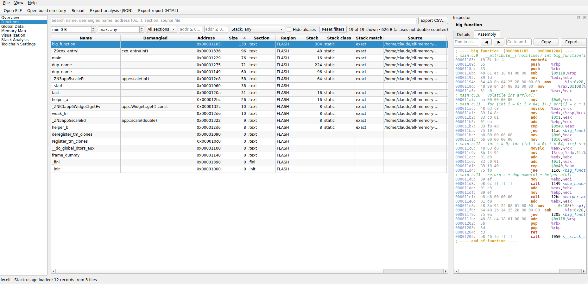
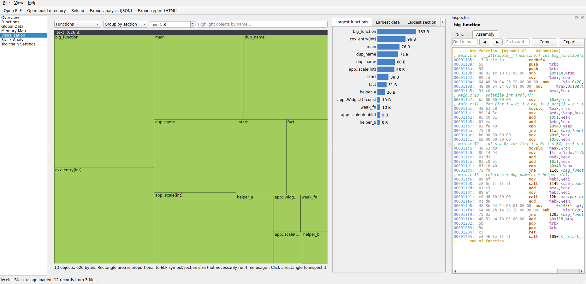

# ELF Memory Analyzer (`elfmem`)

Desktop tool to see where embedded firmware memory goes: functions, global/static data, sections, regions, stack usage
and assembly - from an ELF file, with no compiler required.

## Architecture and technology choices
| Choice | Why | Trade-off |
|---|---|---|
| Python 3.10+ | Fast to develop, easy to test | Large ELFs are slower than native code |
| **pyelftools** | Mature ELF + DWARF parser; no custom parser | DWARF is slow on huge images, so it runs in the background and is optional |
| **PySide6 / Qt** | Native desktop, model/view scales to 100k rows, LGPL | Larger bundle than Tk |
| External `objdump` | Supports every architecture whose binutils the user already has | Needs a matching target toolchain (clear diagnostics shown otherwise) |
| Custom Qt model + Python filter/sort | ~10x faster than `QSortFilterProxyModel` on 100k symbols | More code |
| Self-painted treemap/bar widgets | No QtCharts dependency; handles 30k+ rectangles | Fewer built-in features |
| pandas | **Not used**: no step needed it | - |

    elfmem/
      models.py             data classes (no Qt, no I/O)
      elf_parser.py         ELF -> sections, segments, symbols (pyelftools)
      symbol_classifier.py  section categories, function/data/other classification
      debug_info.py         DWARF: declaration file/line, line table
      disassembler.py       objdump integration, parsing, source interleaving
      stack_usage.py        .su discovery, tolerant parsing, conservative matching
      callgraph.py          call graph from disassembly + worst-case estimate with explicit limitations
      memory_analyzer.py    region model, section/region accounting, top-N lists
      visualization.py      squarified treemap layout, chart data
      toolchain.py          presets, detection, validation, persisted config
      export.py             CSV / JSON / HTML
      analysis.py           orchestration (phases: ELF -> DWARF -> stack)
      cli.py                headless interface
      gui/                  Qt: main window, panels, models, workers, charts, inspector
    tests/                  pytest suite (builds fixtures with gcc; synthetic ARM ELF; GUI smoke tests)

## Install and run
    python -m venv .venv && . .venv/bin/activate      # Windows: .venv\Scripts\activate
    pip install -e ".[dev]"
    elfmem path/to/firmware.elf          # GUI (or: python -m elfmem)
    elfmem-cli firmware.elf --build-dir build/ --top 15 --json out.json --html out.html

Drag and drop an ELF (or a build directory) onto the window. Packaging: see `packaging.md`.

## Typical workflow
1. **Overview**: general info, warnings, section/category totals, largest functions/data.
2. **Memory Map**: define regions (`FLASH 0x08000000 0x100000`, `RAM 0x20000000 0x20000`) to get usage percentages.
3. **Functions / Global Data**: search (multi-term, address `0x...`), filter by size/section/address/stack, sort, export CSV.
   Double-click a function to open the **Assembly** tab (source interleaved when DWARF exists).
4. **Open build directory** (Ctrl+Shift+O): `.su` files are found recursively and matched to functions.
5. **Visualization**: treemap by section/category/region, click to inspect; bar charts of top consumers.
6. **File -> Export** JSON / HTML / CSV.

## How measurements are defined (read this)
* **File size**, **section sizes**, **PT_LOAD sizes** and **run-time memory** are shown separately and are not interchangeable.
  "Static RAM" = `.data` + `.bss`; stack and heap are never included.
* Sections are classified by **flags/type** (code, read-only, initialized data, NOBITS...). Whether they live in flash or
  RAM is decided only by **regions you configure**. `.data` is counted in RAM by run-time address and in flash by load address.
* Symbol sizes come from `st_size`. Data is classified from symbol type + section; the "Source (DWARF)" column is filled only
  when DWARF has a variable/function at that exact address.
* Aliases (same address) are flagged and not double-counted in totals/charts.

## Stack analysis
* `.su` records are matched in this order: exact name (raw or demangled, return type ignored) -> clone-suffix / parameter-less name
  (*approximate*) -> narrowed by translation unit (ELF `STT_FILE` or DWARF file). If several records or several symbols
  compete without evidence the result is **ambiguous and nothing is assigned**.
* Per-function numbers are never summed. The optional call-path estimate (Stack Analysis page) reports a **lower bound**
  when recursion, indirect calls, dynamic stack, or missing data are involved, and lists those issues.

## Tests
    pytest -q          # 46 tests: ELF parsing vs nm/readelf/objdump, .su parsing/matching, exports, toolchain, GUI flow, 100k-symbol speed

## Known limitations / future work
* `.su` is GCC-style; Clang uses the same parser but is untested against real Clang output. Other vendor formats need a parser plugin.
* Call graph is heuristic (direct call/branch mnemonics from objdump; tail calls only when jumping to another function's entry);
  `-fcallgraph-info` (.ci) ingestion would be more precise. ISR entry points are not connected to callers.
* Inlined or LTO-merged functions may have `.su` records with no ELF symbol (reported as unmatched).
* DWARF: only `DW_OP_addr` variables and subprograms with `low_pc` are indexed; DWARF5 `addrx` forms are skipped.
* Thumb/ARM mode is taken from the symbol's low bit; objdump decides instruction decoding.
* Not yet verified here: non-x86 disassembly (no cross toolchain was available - ARM parsing is covered by synthetic text/ELF tests),
  Windows/macOS runs, and PyInstaller packaging.
* Ideas: linker-script/map-file region import, diff between two ELFs, per-object (library/.o) attribution from `.map`.
